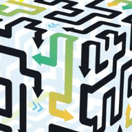
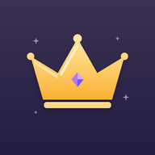

# Ultimate Games

[Play Ultimate Games](https://games.chrisawad.com/)

Games Dashboard is the home for browser games by [Chris Awad](https://github.com/chrisawad). Choose a game below to play it on its own site. To keep a game on your home screen, open it and use its install action or your browser’s install menu.

| Game | How to play | Players |
| --- | --- | --- |
|  [Arrow Cube](https://cube.chrisawad.com/) | Rotate a 3D cube to find a clear exit for each arrow. Clear every face to unlock a larger puzzle. | Solo puzzle |
|  [Bus Jam](https://buses.chrisawad.com/) | Send buses out of a crowded depot in the direction of their roof arrows. Match buses to waiting passengers by color before the stops fill up. | Solo puzzle |
|  [Glow Words](https://words.chrisawad.com/) | Trace hidden words in a glowing letter garden. Choose a reading level, grid size, and word count, then play at your own pace or against the clock. | Solo word search |
|  [Tic Tac Toe](https://tictactoe.chrisawad.com/) | Line up three marks before your opponent. Challenge T-3PO on three difficulty levels, pass one screen between two players, or invite a friend for a match. | Solo vs AI · Local PvP · Online PvP · Invite link, Room code, QR code |
|  [Boxes](https://boxes.chrisawad.com/) | Connect neighboring dots to claim boxes. Closing the fourth side earns another turn. Capture more boxes than your opponent to win. | Solo vs AI · Local PvP · Online PvP · Invite link, Six-character room code, QR code, Public matchmaking |
|  [Queens](https://queens.chrisawad.com/) | Place seven queens so each row, column, and colored region has exactly one. No two queens may touch, even diagonally. | Solo puzzle |

The [game catalog](catalog.json) includes each game’s play URL, source repository, description, play modes, and launcher artwork. Each icon in [icons](icons) comes from the corresponding game’s published web app manifest.

## Dashboard brief

Use **Ultimate Games** for the page heading and browser title, **Dashboard** for the top bar, and **Games Dashboard** for the installed app name. Build a mobile-friendly game library with the deep violet and lavender gradients of Tic Tac Toe and the indigo, plum, and soft pink glow of Glow Words. Keep the original game artwork and give each card a readable description, play modes, and a direct Play link.

Give the dashboard its own launcher icon, manifest identity, and service worker scoped to `/Games-Dashboard/`. Cache the game catalog and icons for offline browsing. Launch games as top-level pages at their own addresses. Each game handles its own installation through its existing install action or the browser’s native install or Add to Home Screen feature.
