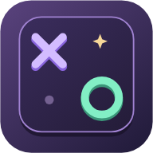

# Ultimate Games

Games Dashboard is the home for five browser games by [Chris Awad](https://github.com/chrisawad). Choose a game below to play it on its own site. To keep a game on your home screen, open it and use its install action or your browser’s install menu.

| Game | How to play | Players |
| --- | --- | --- |
|  [Arrow Cube](https://chrisawad.github.io/arrow-cube/) | Rotate a 3D cube to find a clear exit for each arrow. Clear every face to unlock a larger puzzle. | Solo puzzle |
|  [Bus Jam](https://chrisawad.github.io/Bus-Game/) | Send buses out of a crowded depot in the direction of their roof arrows. Match buses to waiting passengers by color before the stops fill up. | Solo puzzle |
|  [Glow Words](https://chrisawad.github.io/GlowWords/) | Trace hidden words in a glowing letter garden. Choose a reading level, grid size, and word count, then play at your own pace or against the clock. | Solo word search |
|  [Tic Tac Toe](https://chrisawad.github.io/Tic-Tac-Toe/) | Line up three marks before your opponent. Challenge T-3PO on three difficulty levels, pass one screen between two players, or invite a friend for a match. | Solo vs AI · Local PvP · Online PvP · Invite link, Room code, QR code |
|  [Box Game — Dots and Boxes](https://chrisawad.github.io/Box-Game/) | Connect neighboring dots to claim boxes. Closing the fourth side earns another turn. Capture more boxes than your opponent to win. | Solo vs AI · Local PvP · Online PvP · Invite link, Six-character room code, QR code, Public matchmaking |

The [game catalog](catalog.json) includes each game’s play URL, source repository, description, play modes, and launcher artwork. Each icon in [icons](icons) comes from the corresponding game’s published web app manifest.
